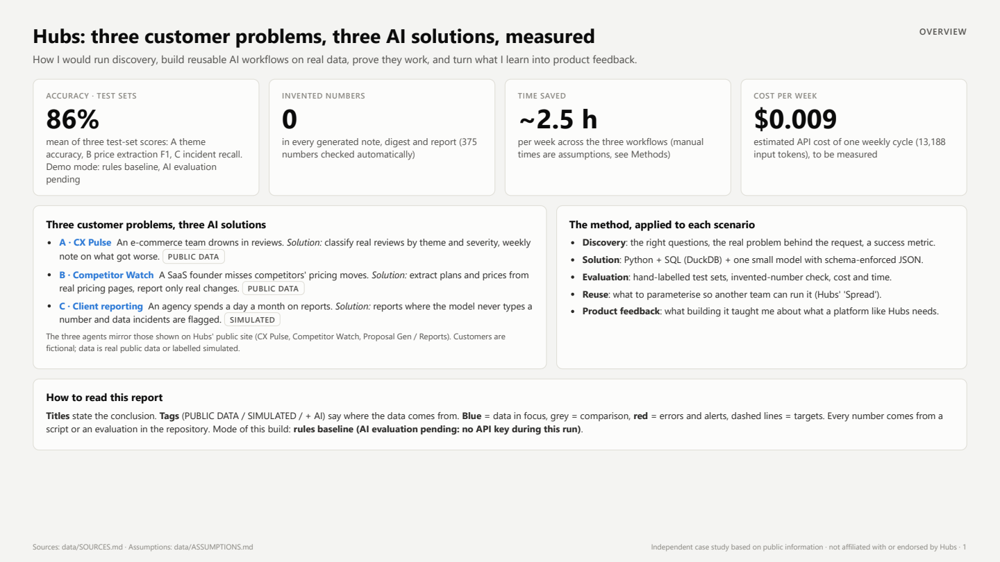
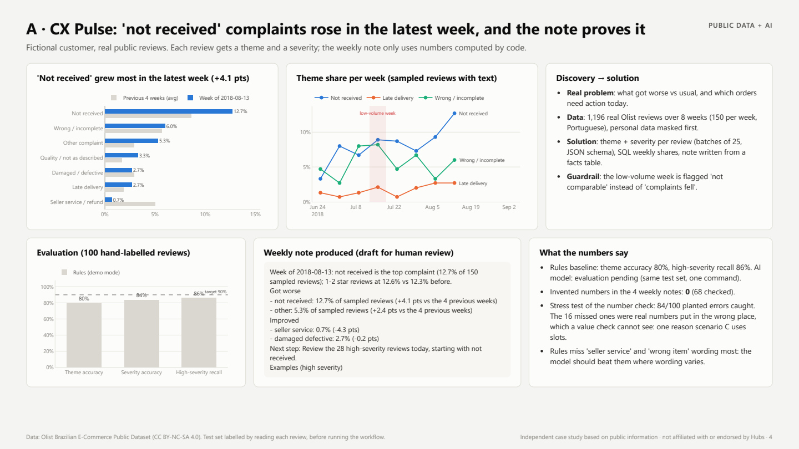
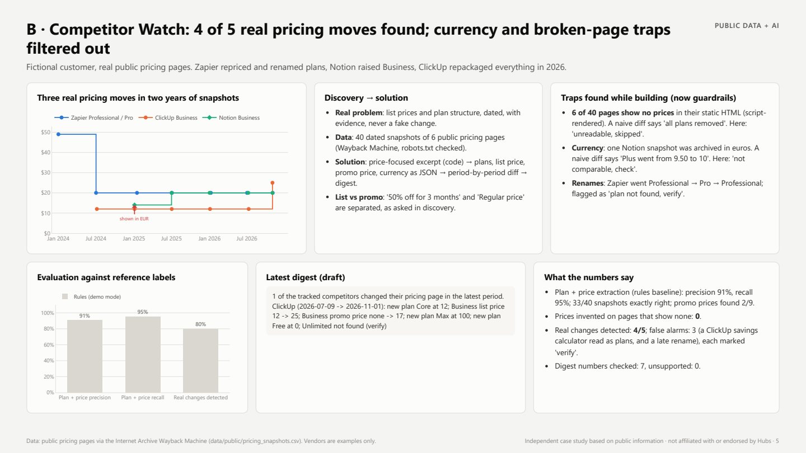
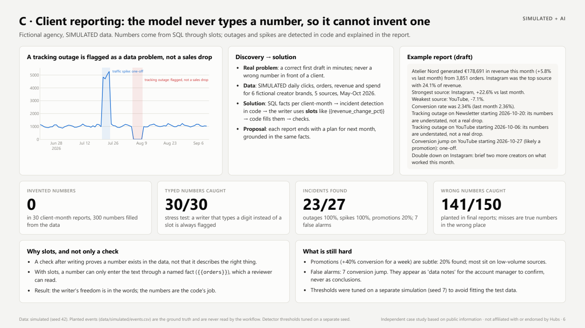
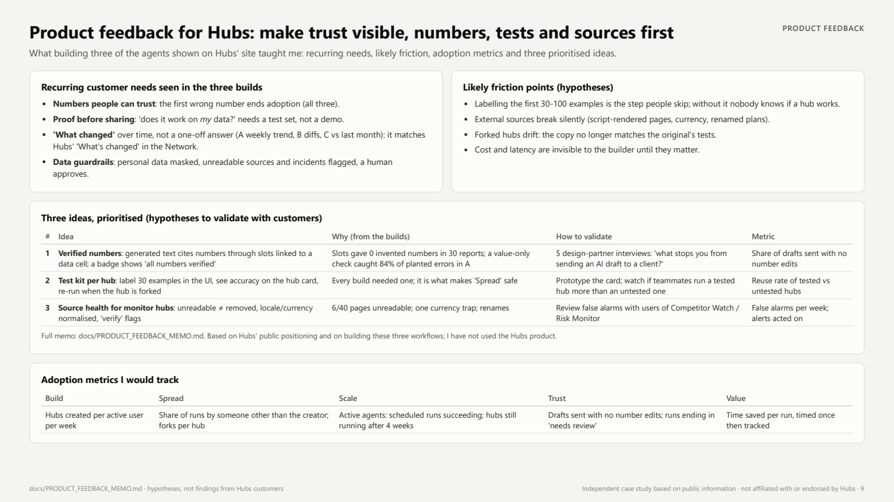

# Hubs: three customer problems, three AI solutions, measured

How I would run discovery, build reusable AI workflows on real data, prove they work, and turn what I learn into product feedback,
written as "what I would do in my first weeks" for the Applied AI Product Associate role at Hubs.

**Read:** [the report (PDF, 11 pages)](docs/Hubs_AppliedAI_CaseStudy.pdf) · [the product feedback memo](docs/PRODUCT_FEEDBACK_MEMO.md) ·
live demos: [A · CX Pulse](https://albt-france.github.io/hubs-applied-ai-case-study/dashboard_A.html) ·
[B · Competitor Watch](https://albt-france.github.io/hubs-applied-ai-case-study/dashboard_B.html) ·
[C · Client report](https://albt-france.github.io/hubs-applied-ai-case-study/dashboard_C.html) ·
[project page](https://albt-france.github.io/hubs-applied-ai-case-study/)

<!-- RESULTS:START -->
**Key results** (demo mode: rules baseline, AI evaluation pending):

| | Result |
|---|---|
| Accuracy on the test sets | **86%** on average (A theme accuracy 80%, B plan/price F1 93%, C incident recall 85%); A high-severity recall 86% |
| Invented numbers | **0** in every generated note, digest and report (375 numbers checked) |
| Time saved | **~2.5 h per week** across the three workflows (manual times are assumptions) |
| Cost | **$0.009 per weekly cycle** (estimate) |
<!-- RESULTS:END -->

> Independent case study based on public information · not affiliated with or endorsed by Hubs. Customers in the scenarios are
> fictional; the data is real public data (**PUBLIC DATA**) or generated by code (**SIMULATED**). I have not used the Hubs product.



| | |
|---|---|
|  |  |
|  |  |

## The three scenarios
Each one mirrors an agent shown on Hubs' public site (hubs.is, read 2026-11-14).

| | Customer problem (fictional customer) | Data | Solution |
|---|---|---|---|
| **A · CX Pulse** | An e-commerce team gets thousands of reviews and notices problems weeks late | **PUBLIC DATA**: 1,196 real Olist reviews over 8 weeks (Portuguese), 100-review test set | Theme + severity per review, weekly shares in SQL, a Monday note written from computed numbers |
| **B · Competitor Watch** | A SaaS founder misses competitors' pricing moves | **PUBLIC DATA**: 40 dated Wayback snapshots of 6 public pricing pages (2024-2026) | Plans and prices extracted as JSON, period-by-period diff with guardrails, weekly digest |
| **C · Client report** | An agency spends a day a month writing client reports | **SIMULATED**: daily performance of 6 fictional creator brands, 27 planted incidents | SQL facts → incident detection → the writer uses slots like `{{revenue}}`, code fills them, checks run |

## The method (same for each scenario)
1. **Discovery**: the questions asked, the real problem behind the request, a success metric agreed up front.
   See [discovery/DISCOVERY_GUIDE.md](discovery/DISCOVERY_GUIDE.md) and the three scenario notes.
2. **Solution**: plain Python + DuckDB SQL + one small, low-cost LLM (set in `workflows/common/llm.py`) returning JSON validated by a schema.
3. **Evaluation**: hand-labelled test sets (`data/eval/`), invented-number check on every output, a stress test of that check
   (wrong numbers planted on purpose), cost and time.
4. **Reuse ("Spread")**: what another team parameterises (taxonomy, URLs, slots), the fixed input/output contract, known limits.
5. **Product feedback**: [docs/PRODUCT_FEEDBACK_MEMO.md](docs/PRODUCT_FEEDBACK_MEMO.md), hypotheses to validate with customers.

## Guardrails
- **Personal data** (e-mails, phones, tax IDs, URLs, names after greetings) is masked before anything is stored or sent to a model.
  The API call log keeps tokens, cost and latency only, never text.
- **Numbers**: every number in a generated note, digest or report is compared with the facts computed by code; a failure marks the
  output NEEDS REVIEW. In scenario C the model cannot type numbers at all (slots).
- **Sources**: a page without prices is "unreadable", never "all plans removed"; a currency switch is "not comparable".
- **Human review**: every output is a draft; nothing is sent automatically.

## Run it
```bash
python -m venv .venv
.venv\Scripts\pip install -r requirements.txt        # Windows (use .venv/bin/pip elsewhere)
python -m workflows run --scenario A                 # or B, C, all
python src/evaluate.py                               # test sets -> outputs/eval/
python src/run_all.py                                # workflows + evaluations + dashboards + PDF + memo
```
- **Without an API key** every workflow runs in **demo mode** (keyword rules and templates) and the report marks the AI columns
  "pending". **With a key**: copy `.env.example` to `.env`, add your API key there, run `python src/run_all.py`.
- Rebuild the data from source (optional): `python src/prepare_reviews.py` (Olist CSVs from Olist's public repository, see
  data/SOURCES.md; downloaded automatically if missing), `python src/collect_pricing.py` (Wayback snapshots, slow on purpose), `python src/generate_sim.py`.
- The PDF is printed by headless Edge or Chrome (`src/build_report.py`).

```
workflows/   cx_pulse/  competitor_watch/  client_report/  common/ (model wrapper, number check, personal-data masking)
src/         prepare_reviews.py  collect_pricing.py  generate_sim.py  evaluate.py  charts.py  build_dashboards.py  build_report.py
data/        public/ (published inputs)  simulated/  eval/ (test sets and labels)  SOURCES.md  ASSUMPTIONS.md
discovery/   DISCOVERY_GUIDE.md  scenario_A_notes.md  scenario_B_notes.md  scenario_C_notes.md
outputs/     latest notes, digest, reports, run summaries, evaluations
docs/        report PDF, memo, dashboards
```

## Sources and licences
- Hubs facts: hubs.is pages read on 2026-11-14 ([data/public/hubs_public_facts.md](data/public/hubs_public_facts.md)).
- Reviews: Olist Brazilian E-Commerce Public Dataset, **CC BY-NC-SA 4.0**. Derived files here keep that licence (non-commercial,
  attribution to Olist, share-alike). Raw CSVs are not redistributed.
- Pricing pages: public pages of Notion, Slack, Asana, Trello, ClickUp and Zapier through the Internet Archive Wayback Machine;
  robots.txt checked, low request rate; raw pages not redistributed. The vendors are examples only.
- Full list with dates: [data/SOURCES.md](data/SOURCES.md). Assumptions: [data/ASSUMPTIONS.md](data/ASSUMPTIONS.md).

## Limits
- Fictional customers; no Hubs customer, number or product access is used or implied.
- Small test sets (100 reviews, 40 snapshots, 30 client-months) labelled by one person.
- Manual times behind "time saved" are assumptions; accuracy, checks and workflow times are measured.
- Scenario C uses simulated data; its detector thresholds were tuned on a separate simulation (seed 7).
- Scenario B's rule baseline was written after reading the pages, so it is optimistic.

## Methods
AI-assisted workflow: I used Claude, mainly to write scripts faster. I drove the project: I defined the questions, chose and validated the data sources, made the analytical decisions and checked every result.
